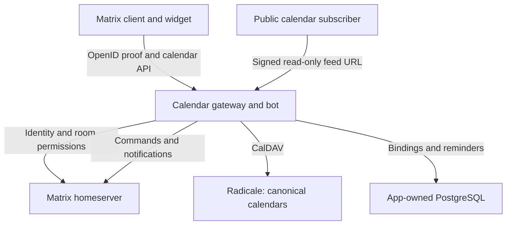

# Architecture

[Documentation](./README.md) · [Development guide](./DEVELOPMENT.md) · [Data model](./data-model.md) · [Architecture decisions](./adrs/README.md)

Matrix Calendar Widget is a React widget and one NestJS gateway/bot service backed by Radicale. Matrix supplies identity, room context, and notifications; CalDAV stores the calendar. This page explains the current boundaries and where the code implements them. Release evidence and deployment readiness are tracked separately in [RELEASE.md](./RELEASE.md).

## Components and data flow

The widget uses React, Matrix Widget Toolkit, MUI, and FullCalendar. FullCalendar is a view layer. The gateway validates requests, checks authorization, performs CalDAV operations, and hosts the optional bot, setup, reminder, and public-feed services. They remain one deployable server; no additional service boundary is needed for the current scope.

The project-owned [Radicale authentication module](../radicale-auth/README.md) validates tagged, short-lived Matrix OpenID proofs. It rejects ordinary passwords. PostgreSQL holds application metadata when configured; it is independent of Radicale's calendar store and the Matrix homeserver's database.

## Follow an event edit through the code

1. [`CalendarHome`](../matrix-calendar-widget/src/components/calendar/CalendarHome.tsx) and the calendar editor use domain types and the repository supplied by [`CalendarRepositoryProvider`](../matrix-calendar-widget/src/calendar/CalendarRepositoryProvider.tsx).
2. [`GatewayCalendarRepository`](../matrix-calendar-widget/src/calendar/GatewayCalendarRepository.ts) and [`GatewayCalendarTransport`](../matrix-calendar-widget/src/calendar/GatewayCalendarTransport.ts) translate those operations into HTTP requests. [`AppContainer`](../matrix-calendar-widget/src/AppContainer.tsx) obtains short-lived identity proof from the Matrix host.
3. [`MatrixAuthMiddleware`](../matrix-calendar-server/src/middleware/MatrixAuthMiddleware.ts), the guards, and [`CalendarGatewayController`](../matrix-calendar-server/src/controller/CalendarGatewayController.ts) validate identity, input, room membership, and action-specific permission.
4. Personal requests use the validated actor's proof. Room-target requests additionally resolve the exact server-side binding and use [`RoomCalendarCalDavAccess`](../matrix-calendar-server/src/service/RoomCalendarCalDavAccess.ts) with the configured room principal.
5. [`CalDavEventClient`](../matrix-calendar-server/src/caldav/CalDavEventClient.ts) reads the canonical resource. [`ICalendarEventCodec`](../matrix-calendar-server/src/caldav/ICalendarEventCodec.ts) applies the supported patch while preserving opaque content; conditional writes use the resource's ETag. A stale ETag produces a conflict instead of silently overwriting another edit.
6. The widget displays the result or an actionable error. Optional room action notices run after a successful write; a notice failure does not undo the CalDAV change.

The source [`CalendarRepository` interface](../packages/calendar/src/repository/calendarRepository.ts) is the API contract. It exposes explicit calendar and event operations; avoid maintaining a second, approximate TypeScript interface in documentation. The shared domain must remain independent of FullCalendar, Redux, Matrix event shapes, and DAV response formats.

## Sources of truth

| Concern                                                             | Owner                                                               |
| ------------------------------------------------------------------- | ------------------------------------------------------------------- |
| Calendar collection and supported display properties                | CalDAV/Radicale                                                     |
| Event UID, fields, recurrence, revision metadata, attendees, alarms | Canonical iCalendar resource in Radicale                            |
| Matrix identity, membership, power, and encryption state            | Matrix homeserver, checked by the gateway                           |
| Room-to-calendar binding                                            | Static server configuration plus optional app-owned binding store   |
| Matrix reminder configuration and delivery claims                   | App-owned PostgreSQL store                                          |
| Public-feed share and revocation                                    | Radicale's native token-sharing store in its persistent data volume |
| Public-feed link signing key                                        | Operator-managed gateway secret                                     |
| Widget display preferences                                          | Local UI state; never an authorization source                       |

See [the data model](./data-model.md) for the distinction between resource identity, event UID, occurrences, and ETags.

## Personal and room-owned calendars

There are two separate CalDAV ownership paths:

| Path                | CalDAV principal                                                   | Gateway authorization                                                                                |
| ------------------- | ------------------------------------------------------------------ | ---------------------------------------------------------------------------------------------------- |
| Personal calendar   | Authenticated Matrix user's validated, request-scoped OpenID proof | Identity, current room-context membership, and applicable action policy                              |
| Room-owned calendar | Selected process-wide application-service or normal-bot account    | Requesting actor's identity, current room membership, action power, and exact server-managed binding |

Application-service mode is the default. `bot-account` explicitly selects the server's normal bot account; changing mode selects a different Radicale home and does not migrate calendars. The user's widget proof identifies the actor; it is not substituted for the room principal's CalDAV proof. Bot commands derive their actor and room from the authenticated Matrix event, then recheck authorization and binding for each operation.

[ADR014](./adrs/adr014-split-widget-and-bot-calendar-principals.md), [ADR015](./adrs/adr015-server-managed-room-calendar-bindings.md), [ADR041](./adrs/adr041-optional-normal-bot-account-for-room-operations.md), and [ADR043](./adrs/adr043-moderator-room-calendar-setup.md) define these contracts. Per-user bot calendars and external private application credentials remain separate work.

### Permission checks

Joined room members may read the calendar. Event writes use the dedicated calendar event-write power, then `events_default`, then Matrix's default of 0. Calendar-management operations use the dedicated calendar-manage power, then `state_default`, then Matrix's default of 50. Only a genuine missing power-level event (`M_NOT_FOUND`) permits the defaults; network, permission, or malformed-state failures deny access.

For room version 12, the policy can recognize implicit creator power from the authoritative current `m.room.create` event, including its sender and `additional_creators`. It requires the exact supported room version and valid identities. Client-supplied creator claims or unknown room versions grant no implicit power. The implementation and regressions live in [`MatrixCalendarAuthorization.ts`](../matrix-calendar-server/src/service/MatrixCalendarAuthorization.ts) and its adjacent tests; the protocol reference is the [Matrix room-version 12 specification](https://spec.matrix.org/v1.19/rooms/v12/).

The browser uses capabilities to present controls. The server remains the authorization boundary.

### Bindings and setup

`ROOM_CALENDAR_BINDINGS` supplies validated static room/calendar pairs. A room and calendar each belong to at most one binding in the configured registry. When an app-owned binding store is configured, the registry validates static and dynamic entries together and exposes ready dynamic rows only; pending or invalid entries grant no access.

The separately enabled `!calendar setup` flow may append one durable binding after actor, bot, room-state, and widget preconditions pass. It chooses the opaque calendar ID, provisions and verifies the collection, and installs the widget. It does not rename, rebind, or delete existing bindings. Static entries remain authoritative for their rooms. See [bot setup](./bot-calendar.md) and [ADR043](./adrs/adr043-moderator-room-calendar-setup.md).

Radicale's `owner_only` policy grants a principal access to its entire home. Gateway bindings scope requests at the application boundary; they are not per-room Radicale ACLs. Keep the selected room principal within one trusted organizational boundary or provide equivalent backend isolation.

## Calendar semantics and preservation

New calendars are VEVENT-only. Existing mixed collections can expose their VEVENT members while preserving VTODO, VJOURNAL, and unsupported objects. VTODO-only, VJOURNAL-only, and address-book collections do not become calendar UI features.

The editor and projector intentionally support a bounded subset of iCalendar. Unsupported data remains canonical in Radicale; some unsupported recurrence/timezone forms cannot be displayed, and not every unsupported form can be diagnosed. The widget's visible event list is therefore not a complete export of a calendar. Supported edits must preserve unknown properties and reject ambiguous mutations.

Time values retain floating, named-zone, or all-day semantics. All-day end dates and query-range ends are exclusive. Projection is bounded to the requested window with documented work limits. [The data model](./data-model.md), [timezone guide](./timezones-ical-data.md), and [fixtures](../fixtures/ical/README.md) are the starting points for changes to those rules.

## Reminders and room action notices

A canonical `VALARM` defines alarm timing. The separate reminder store associates supported event/alarm identities with Matrix delivery. The current merged delivery target is a whole-room mention using `m.mentions.room`; selected recipients and explicit all-day Matrix schedules are tracked separately in [#382](https://github.com/0cwa/matrix-calendar-widget/issues/382).

Reminder configuration and delivery have independent default-off gates. Delivery also requires room access, a valid binding, service configuration, and the app-owned database. The scheduler rereads canonical event/alarm data and rechecks binding, encryption state, and mention permission before sending. Native scheduled delivery refuses encrypted or unknown room state. Persistent claims and stable Matrix transaction IDs support retries; they do not promise exactly-once delivery. Coordination assumes one server replica.

Room action notices are another independent, default-off capability. They are best-effort messages after successful room-target widget changes, suppress automatic mentions, and use the SDK's encryption-aware sender. They do not establish support for encrypted scheduled reminders. The implementation lives in [`src/reminder/`](../matrix-calendar-server/src/reminder/) and [`RoomCalendarEventAuditService`](../matrix-calendar-server/src/service/RoomCalendarEventAuditService.ts).

## Public calendar feeds

[ADR045](./adrs/adr045-public-calendar-feeds.md) defines opt-in public ICS subscriptions. An authenticated owner or authorized room-calendar manager explicitly publishes a calendar, creating a native Radicale read-only share. A gateway `GET`/`HEAD` route verifies the signed link and validates the complete current VEVENT-only response on each request. It returns Radicale's canonical bytes, rather than rebuilding a feed from the bounded widget projection. The public URL uses the gateway origin; Radicale and its share-management endpoints remain private.

Anyone with the public URL can read the published calendar. Links intentionally survive changes to Matrix membership or manager power. Unpublishing or native token revocation stops future reads, but cannot remove copies already downloaded. Operators must unpublish before changing or removing a static binding. The Radicale share store and dedicated signing key must be restored consistently. These feeds provide read-only subscription; they do not provide private CalDAV editing.

## Configuration and operational boundaries

[Configuration](./configuration.md) owns environment-variable names, defaults, and setup instructions. Read access, event writes, moderator setup, reminder configuration, reminder delivery, action notices, and public publication use separate gates. Enabling one does not implicitly enable the others.

The [controlled beta](./beta-scope.md) uses an independent project-owned Radicale store, an app-owned PostgreSQL store, one server replica, and selected Element Web/Desktop journeys. Tests against pinned fixtures do not certify a different client, existing managed data store, proxy, database, or deployment host. Use [deployment](./deployment-docker.md), [backup/recovery](./backup-recovery.md), and the [release ledger](./RELEASE.md) for operator work.

## Inherited code and future changes

The project is a [hard fork of NeoDateFix](./UPSTREAM.md). The ordinary widget route and startup no longer initialize the inherited meeting Redux/invitation flow. Legacy deep links redirect to calendar home. Some shared utilities, meeting-era modules, and server providers remain, while inherited meeting HTTP/RPC entry points are disabled for the calendar pilot.

The [legacy entry-point inventory](./legacy-entry-points.md), [server inventory](./legacy-server-inventory.md), and [roadmap](./ROADMAP.md) explain the remaining retirement sequence. Preserve useful shared primitives and upstream attribution; trace runtime/import use before deleting dependencies. The [archived NeoDateFix data model](./archive/neodate-data-model.md) documents historical meeting behavior only.

MSC4496 remains an interoperability design reference, not a required homeserver runtime feature. Changes to the boundaries on this page require the relevant ADR and regression coverage described in [Contributing](../CONTRIBUTING.md).
